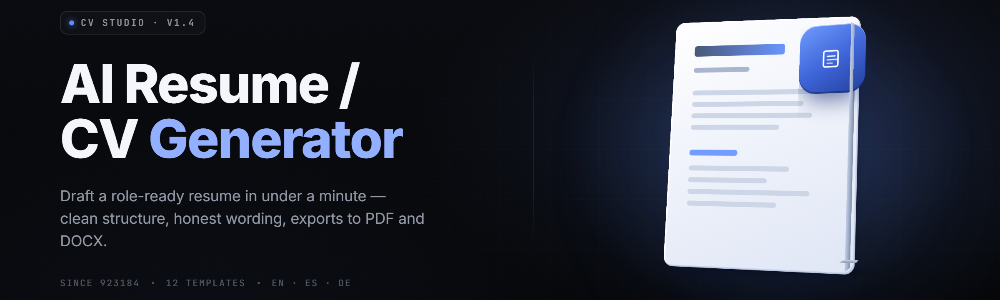

  
  
  

  

  
  

---

### Resume Forge AI Builder — AI resume / CV generator (2026)

Local Windows desktop app that reads your job target and your work history, then writes, scores, and exports ATS-clean resumes and CVs. No account. No cloud. Runs offline.

---

## 🧾 Frequently Asked Questions

<strong>Does Resume Forge AI Builder need an internet connection?</strong>

No. The generation engine, the ATS parser, and the scoring model all run locally on your machine. The only time the app touches the network is the optional one-time model-pack check when you first launch a new version.

<strong>What file formats can it export?</strong>

DOCX, PDF (text-selectable, not image), plain Markdown, and ATS-safe TXT. Every export is run back through the internal parser before it hits disk so you can see exactly what a screening bot would read.

<strong>Will it work with a scanned or image-only resume I already have?</strong>

Yes, through the Import module. Drop a PDF or image in, the OCR pass extracts text, and the parser rebuilds the sections. Image quality matters — 200 DPI or better.

<strong>Do I need Python, Node, or Git installed?</strong>

No. You download one archive, extract it, and double-click the `.exe`. Every runtime is bundled.

<strong>Can it tailor one base resume to many job postings?</strong>

That is the core workflow. Paste a job description, the app pulls the keyword set, rewrites your bullets against it, and shows a match score before and after. You review every change — nothing is written to the resume until you accept it.

<strong>Does it store my personal data anywhere?</strong>

Profiles live in a local SQLite file inside the app folder. Nothing leaves the machine unless you copy an export out yourself.

<strong>How accurate is the ATS score?</strong>

It is a heuristic, not a guarantee. It models the most common parsers (keyword extraction, section detection, contact-block parsing). Treat it as a directional signal, not a hiring decision.

<strong>Can I use my own fonts and section names?</strong>

Yes. The Style module has template presets, and the Layout module lets you rename, reorder, and toggle every section. ATS-safe mode locks the naming to common conventions when you want maximum parser compatibility.

<strong>Is it a subscription?</strong>

No. It ships as a standalone release. You download the current build and run it.

<strong>What happens if a generation looks wrong?</strong>

Every rewrite is shown as a diff against your original text. Reject it, edit it, or regenerate just that bullet. The undo stack keeps the last 50 operations.

---

## 🪟 Compatibility & Platform Support

| Platform | Support | Notes |
|---|---|---|
| Windows 11 (x64) | ✅ Full | Primary target, tested on 23H2 and 24H2 |
| Windows 10 (x64) | ✅ Full | 21H2 or later |
| Windows 10/11 (ARM64) | ⚠️ Partial | Runs under emulation, export is slower |
| Windows Server 2019+ | ✅ Full | Headless batch mode available |
| macOS / Linux | ❌ Not shipped | Desktop `.exe` build is Windows-only |

---

## 🖥️ System Requirements

| Component | Minimum | Recommended |
|---|---|---|
| OS | Windows 10 21H2 (x64) | Windows 11 24H2 (x64) |
| CPU | 4 cores / 2.4 GHz | 8 cores / 3.2 GHz |
| RAM | 4 GB | 16 GB |
| Storage | 2.5 GB free | 8 GB free (SSD) |
| GPU | Integrated, no acceleration | 6 GB VRAM for the offline model pack |
| Display | 1280×720 | 1920×1080 |
| .NET | Bundled | Bundled |
| Network | Not required | Optional for model-pack updates |

---

## 🗂️ Overview

| Category | Details |
|---|---|
| Product type | Windows desktop application (`.exe`) |
| Purpose | Generate, score, and export ATS-optimized resumes and CVs |
| Core engine | Local language model + rules-based ATS parser |
| Input | Existing resume, pasted work history, job description |
| Output | DOCX, PDF, Markdown, ATS-safe TXT |
| Storage | Local SQLite profile store |
| Distribution | GitHub project page → landing page download → extract → run |

Resume Forge AI Builder treats your resume as a document that has to survive two readers at once: the automated parser and the human recruiter. The app writes for both. It generates the content, then runs that content back through a parser simulation so you can see the resume the way a screening system reads it — sections found, keywords matched, contact block parsed, dates normalized.

---

## 📚 Table of Contents

- [Frequently Asked Questions](#-frequently-asked-questions)
- [Compatibility & Platform Support](#-compatibility--platform-support)
- [System Requirements](#️-system-requirements)
- [Overview](#️-overview)
- [Module Status](#-module-status)
- [What Is Resume Forge AI Builder](#-what-is-resume-forge-ai-builder)
- [The Problem](#-the-problem)
- [The Solution](#-the-solution)
- [Key Features](#-key-features)
- [Comparison](#-comparison)
- [Usage Guidelines](#-usage-guidelines)
- [Installation](#️-installation)
- [Quick Start](#-quick-start)
- [Module Catalog](#-module-catalog)
- [Generation & Writing Modules](#-generation--writing-modules)
- [Scoring & ATS Modules](#-scoring--ats-modules)
- [Import & Parsing Modules](#-import--parsing-modules)
- [Layout & Style Modules](#-layout--style-modules)
- [Export & Integration Modules](#-export--integration-modules)
- [Troubleshooting Flow](#-troubleshooting-flow)
- [Known Issues](#-known-issues)
- [Tips for Best Results](#-tips-for-best-results)

---

## 🧩 Module Status

| Module | Status | Description |
|---|---|---|
| Generation Engine | ✅ Working | Writes and rewrites resume bullets from your history + target |
| ATS Parser Sim | ✅ Working | Re-reads exports as a screening bot would |
| Match Scorer | ✅ Working | Keyword + semantic score against a job description |
| Import / OCR | ✅ Working | Extracts text from existing PDFs and images |
| Section Detector | ✅ Working | Finds and normalizes standard resume sections |
| Style Templates | ✅ Working | Preset layouts with ATS-safe variants |
| Export Pipeline | ✅ Working | DOCX, PDF, MD, TXT with parse-back check |
| Profile Store | ✅ Working | Local SQLite, multi-profile |
| Diff Review | ✅ Working | Every rewrite shown as an accept/reject diff |
| Batch Tailoring | ✅ Working | One base resume, many job postings |

---

## 📄 What Is Resume Forge AI Builder

| Term | Explanation |
|---|---|
| Generation Engine | The local model that drafts and rewrites resume content |
| ATS Parser Sim | A re-implementation of common screening parsers used to test your export |
| Match Score | A 0–100 signal of how well a resume aligns to a given job description |
| Keyword Set | The extracted terms a posting rewards, ranked by weight |
| ATS-Safe Mode | A layout lock that forces conventional section naming and structure |
| Diff Review | Side-by-side accept/reject view of every generated change |
| Profile | A saved bundle of your history, target roles, and style choices |

**Why builders keep it on the machine:**
- Your history never leaves the box — no account, no upload.
- The parser sim catches the exact failures that silently drop resumes.
- One base profile drives unlimited tailored exports.
- Exports are verified by re-parsing before they touch disk.
- Offline generation means it works on a locked-down work laptop.

---

## ⚠️ The Problem

- You write one resume and send it to forty postings that all want different keywords.
- Screening software reads your resume before a human ever does — and it reads it wrong.
- Bullets describe what you did, not what the posting asked for.
- Column layouts and graphics look great and parse like noise.
- Tailoring by hand takes an hour per application, so you stop doing it.
- You have no idea why you got filtered — no feedback loop exists.
- Older resumes live in PDFs you can't easily edit.

---

## 🛠️ The Solution

| Problem | Solution |
|---|---|
| One resume for forty postings | Batch Tailoring rewrites a base profile per posting |
| Parser reads it wrong | ATS Parser Sim shows the parsed result before you send |
| Bullets miss the ask | Generation Engine rewrites against the extracted keyword set |
| Columns parse as noise | ATS-Safe Mode forces conventional structure |
| Manual tailoring is slow | Tailor workflow runs in under a minute per posting |
| No feedback on rejection | Match Score + parser output give a directional signal |
| Old PDFs are stuck | Import / OCR pulls text back into an editable profile |

---

## ⭐ Key Features

| Feature | Description | Benefit |
|---|---|---|
| Generation Engine | Drafts and rewrites bullets from your raw history | Turns notes into recruiter-ready lines |
| Match Scorer | Scores resume vs. job description | Know your alignment before applying |
| ATS Parser Sim | Re-reads exports as a screening bot | Catch silent parse failures |
| Import / OCR | Text extraction from PDF and image | Recover old resumes |
| Section Detector | Normalizes standard section names | Keep parsers happy |
| Diff Review | Accept/reject every generated change | You stay in control |
| Style Templates | Preset layouts, ATS-safe variant | Fast, consistent formatting |
| Batch Tailoring | One profile, many postings | Scale applications |
| Profile Store | Local multi-profile SQLite | Keep versions organized |
| Export Pipeline | DOCX/PDF/MD/TXT with parse-back | Deliverable that survives |
| Keyword Extractor | Weighted term set from a posting | Target the right language |
| Undo Stack | 50-step history | Recover from a bad pass |

---

## 📊 Comparison

| Aspect | The Old Way (buy / install / manual) | This Tool |
|---|---|---|
| Cost | Paid resume services per revision | Standalone release, no per-use fee |
| Turnaround | Days waiting on a writer | Under a minute per generation |
| Tailoring | Manual, one at a time | Batch across many postings |
| Parser feedback | None | ATS Parser Sim built in |
| Privacy | History uploaded to a service | Local only |
| Formatting | Fixed templates you can't edit | Editable layout + style modules |
| Recovery | Rebuild from scratch | Import / OCR from existing PDFs |
| Verification | Send and hope | Parse-back before export |

---

## ✅ Usage Guidelines

| Allowed | Not allowed |
|---|---|
| Generate resumes and CVs for yourself | Submitting resumes for people without consent |
| Tailor to postings you're applying to | Fabricating credentials or employers |
| Import your own documents | Reselling the build as your own product |
| Use offline on a work machine | Circumventing a platform's terms of service |
| Batch-export your own profiles | Distributing generated content as fact without review |

---

## ⚙️ Installation

1. **Get the archive.** Open the project page, follow the download link, and pull the latest release archive for your Windows build.

  

2. **Extract it.** Right-click the archive and extract to a folder you own (avoid `Program Files` unless you run as admin). Do not run it from inside the zip viewer — the bundled model pack won't resolve.

3. **Run the `.exe`.** Double-click the launcher inside the extracted folder. On first launch the app unpacks its local model pack (about 90 seconds) and writes a profile database next to itself. No install wizard, no registry entries, no services.

---

## 🚦 Quick Start

1. 🧾 **Create a profile.** Enter your name, contact block, and target role. This becomes the base every export derives from.
2. 📥 **Import or paste your history.** Drop an old resume for OCR, or paste raw work notes into the editor.
3. 🎯 **Paste a job description.** The Keyword Extractor builds a weighted term set and shows your starting Match Score.
4. 🧠 **Generate.** Run the Generation Engine. Review each rewrite in Diff Review and accept what fits.
5. 📤 **Export and verify.** Pick a format, run the ATS Parser Sim on the result, then save.

---

## 🗃️ Module Catalog

Resume Forge AI Builder ships as a set of independent modules that share the profile store and the export pipeline. Each category below lists the modules it contains and what they do.

---

## ✍️ Generation & Writing Modules

The generation layer is the part that actually writes. It takes your raw history and the extracted keyword set and produces bullets that read like a person wrote them for this specific posting.

**Bullet Rewriter** — rewrites a single line against the target keyword set.
**Summary Composer** — drafts the top-of-resume summary from role + seniority.
**Achievement Miner** — pulls quantified results out of your raw notes.
**Tone Control** — shifts register between formal, direct, and executive.
**Verb Upgrader** — replaces weak openers with strong action verbs.
**Length Balancer** — trims or expands a section to a target line count.
**Skills Clusterer** — groups loose skills into scannable categories.

---

## 🧪 Scoring & ATS Modules

The scoring layer answers one question: does this resume survive the machine? It models the parsers that screen before a human reads.

**Keyword Extractor** — builds a weighted term set from a posting.
**Match Scorer** — 0–100 alignment signal, before and after tailoring.
**ATS Parser Sim** — re-reads your export the way a screening bot would.
**Section Detector** — confirms every standard section is found.
**Contact Parser** — verifies email, phone, and links are extractable.
**Date Normalizer** — forces consistent date formats across roles.
**Density Check** — flags over-stuffed or under-filled sections.

---

## 📥 Import & Parsing Modules

The import layer rescues the resumes you already have. PDFs, images, and old DOCX files come in and land as an editable profile.

**PDF Text Extract** — pulls selectable text from existing PDFs.
**OCR Pass** — extracts text from image-only documents.
**DOCX Reader** — reads legacy Word files into the profile store.
**Layout Reconstructor** — rebuilds sections from loose extracted text.
**Contact Recovery** — finds and separates the contact block.
**Duplicate Merge** — folds an imported history into an existing profile.

---

## 🎨 Layout & Style Modules

The layout layer controls how the document looks without breaking the parser. Every style choice has an ATS-safe counterpart.

**Template Presets** — classic, modern, and compact starting points.
**ATS-Safe Mode** — locks naming and structure to common conventions.
**Section Reorder** — drag sections into the order you want.
**Column Toggle** — single-column lock for maximum parser compatibility.
**Font Manager** — bundled fonts with metric-safe fallbacks.
**Spacing Control** — line and margin tuning that survives export.

---

## 📤 Export & Integration Modules

The export layer turns a reviewed profile into a deliverable and verifies it before it leaves the app.

**PDF Export** — text-selectable output, never image-only.
**DOCX Export** — editable Word file with preserved structure.
**Markdown Export** — plain-text deliverable for version control.
**ATS-Safe TXT** — the most parser-friendly flat output.
**Parse-Back Check** — re-parses every export before saving.
**Batch Export** — writes multiple tailored versions in one pass.
**Version Tagging** — stamps each export with profile + target role.

---

## 🧯 Troubleshooting Flow

If something looks wrong, walk the chain in order:

1. **Generation looks off** → check the keyword set first. A thin posting gives the engine little to target.
2. **Match Score won't move** → confirm the posting text pasted in full, including the requirements block.
3. **ATS Parser Sim shows missing sections** → switch to ATS-Safe Mode and re-export.
4. **Import gives garbage text** → the source was likely image-only; run the OCR Pass at higher DPI.
5. **Export fails to save** → check the target folder isn't read-only or in a synced cloud path.
6. **App won't launch** → confirm you extracted the archive first; running from inside the zip breaks the model pack.

---

## 🐛 Known Issues

| Issue | Solution |
|---|---|
| First launch stalls on model unpack | Wait ~90s; ensure 2.5 GB free on the drive |
| PDF export renders as image on some viewers | Re-export in ATS-Safe Mode; viewer is flattening layers |
| OCR produces broken line breaks | Raise scan DPI to 200+ and re-run Import |
| Batch Tailoring slows with 20+ postings | Reduce batch size to 10 and re-run |
| Fonts shift on another machine | Use a bundled font; system fonts may not be present |
| Profile DB grows large | Archive old profiles from the Profile Store panel |

---

## 💡 Tips for Best Results

- Paste the **full** job description, including the requirements section — thin input, thin output.
- Keep one clean base profile and tailor from it rather than editing exports by hand.
- Always run the ATS Parser Sim on your final export before sending.
- Use ATS-Safe Mode for large-company portals; relaxed mode for direct-to-recruiter sends.
- Quantify achievements when you can — the Achievement Miner will prompt for numbers.
- Keep bullets to one or two lines; the Density Check will flag the rest.
- Export to DOCX when a portal asks for an editable file, PDF when it asks for a final.
- Version-tag every export so you can trace which version went where.

---

Resume Forge AI Builder exists because the resume is now read by two audiences, and only one of them is human. It writes for both, scores the result, and proves the export survives the parser before you ever hit send. Everything runs on your machine, so the only thing you upload is the application you decide to submit.

  

